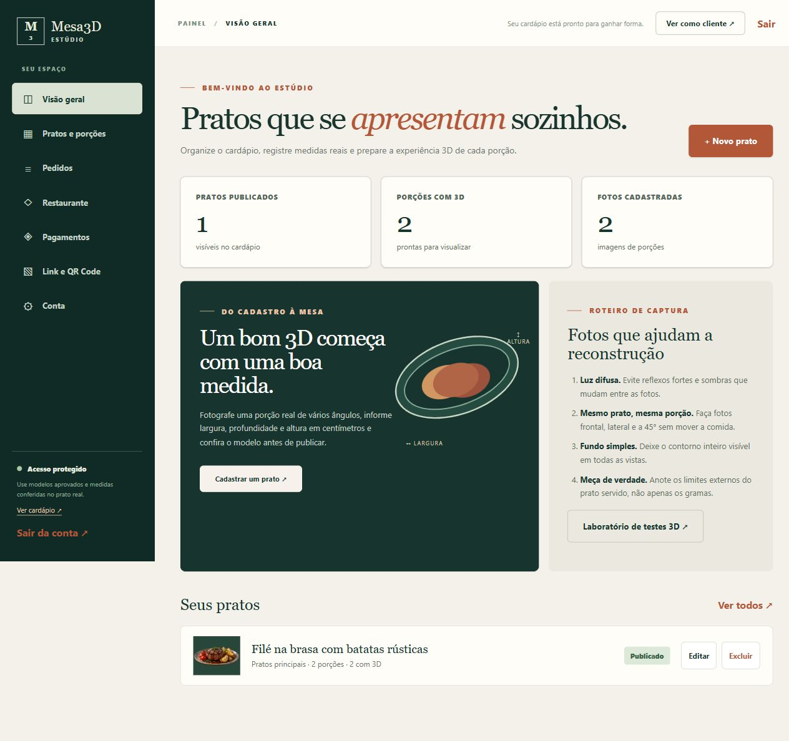
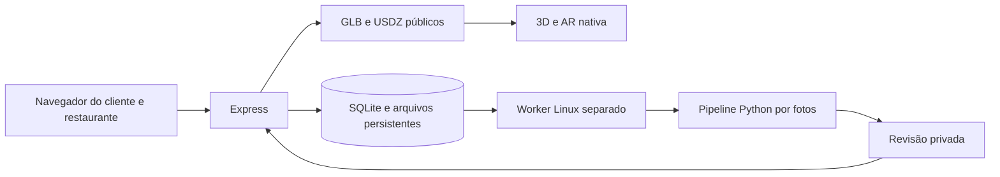
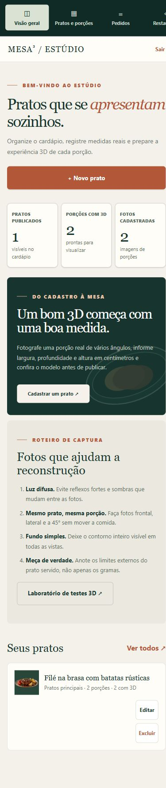

# Mesa3D

### Do cardápio à mesa, em três dimensões.

Cardápio digital com fotos, porções, modelos 3D, realidade aumentada e pedidos na mesa. O visual do Mesa3D encontra os recursos de preparação de modelos do PratoAR, com operação pelo navegador.

**Node.js 24+ · Express · SQLite · GLB / USDZ · AR nativa**



## O que está entregue

| Área | Situação |
| --- | --- |
| Cardápio e gestão | Busca, categorias, porções, carrinho, QR, pedidos e estúdio autenticado |
| Modelos 3D | Importação GLB, medidas, calibração, revisão e publicação |
| Carregamento | Foto de apoio, nova tentativa, modelo original e alternativa sem WebGL |
| AR | Integração nativa GLB/USDZ; validação física pendente |
| Geração por fotos | Fila, worker e revisão privada implementados; ativação bloqueada até validar servidor gratuito |
| Afiliados | Proposta documentada; comissões ainda não implementadas |

O restaurante usa o navegador. O aplicativo Windows anterior sai do fluxo ativo. O SQLite existente pode ser reaproveitado após backup; não é necessário criar banco remoto.

## Começar

```powershell
npm ci
npm start
```

Abra [localhost:8080](http://localhost:8080). Requer Node.js 24 ou superior. O cardápio demonstrativo abre sem configuração administrativa; a gestão exige autenticação. Consulte o [manual de operação](OPERACAO.md) para configurar contas e ambiente.

Os dados ficam por padrão em `data/`. Configure `MESA3D_DATA_DIR` para reaproveitar outra instalação. O template `.env.example` lista as opções; credenciais, banco e uploads reais não pertencem ao Git.

## Arquitetura



A geração recebe fotos, acompanha uma tarefa e entrega uma prévia privada. Somente aprovação explícita publica o modelo. Cancelamento, repetição limitada, lease, isolamento por restaurante e identificação do modelo protegem o catálogo de resultados antigos.

O processamento permanece **desativado por padrão**. Sua liberação exige Linux compatível, recursos suficientes, HTTPS, worker saudável e aceite com captura real e digest do runtime. Nenhuma API paga ou implantação foi ativada.

## Visual Mesa3D

Verde floresta, creme, terracota e títulos serifados preservam a identidade. Os refinamentos incluem foco visível, campos legíveis, alvos de toque, sombras discretas e adaptação móvel. As skills MengTo orientam o trabalho de design; não executam melhorias automaticamente.



## Verificação e limites

```powershell
npm test
npm audit
```

A entrega inclui 54 testes Node e 21 testes Python de fotos, adaptador e pipeline. Os testes controlados do worker não constituem uma reconstrução pesada no servidor de produção. Há smoke HTTP de GLB, MIME, Range e decoders.

Câmera, rastreamento e escala precisam de testes em iPhone e Android físicos. Hospedagem gratuita com disco persistente e capacidade de reconstrução ainda precisa ser validada. Não usar o filesystem efêmero de funções Vercel para o SQLite. Pagamentos externos dependem de configuração e validação próprias.

## Documentação

- [Relatório final e pendências](docs/RELATORIO-FINAL-2026-11-24.md)
- [Geração por fotos: operação, ativação e rollback](docs/GERACAO-3D-SERVIDOR.md)
- [Integração Mesa3D / PratoAR](docs/MESA3D-INTEGRACAO.md)
- [Refinamento visual e proveniência MengTo](docs/VISUAL-MENGTO.md)
- [Proposta de afiliados](docs/PROPOSTA-AFILIADOS.md)
- [Avisos dos componentes do motor](worker-3d/THIRD_PARTY_NOTICES.md)

Neste workspace, o produto está em `web/` e o motor opcional em `worker-3d/`. No repositório Mesa3D, o conteúdo de `web/` fica na raiz. `frontend/`, `desktop/` e `backend/` são legado preservado, fora da execução ativa. Respeitar as licenças e avisos dos componentes de terceiros.
