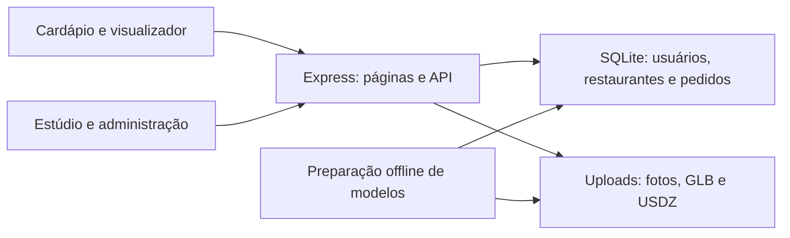

# Estado do backend Mesa3D — 23/11/2026

## Qual backend está ativo

O produto integrado usa **Node.js 24+, Express 5 e SQLite**, em `web/`. O backend Java/Spring de `backend/` e o Next.js de `frontend/` permanecem como legado; não são necessários para executar o Mesa3D integrado.

O restaurante usa o navegador. O SQLite e os uploads ficam no servidor, não no navegador nem num aplicativo Windows do cliente. A configuração `.env` real e um banco de produção não foram usados nesta verificação.

## Verificação HTTP executada

Ambiente: servidor local de teste em `http://127.0.0.1:4320`, conta e dados fictícios. Não representa uma implantação pública.

| Verificação | Resultado observado |
| --- | --- |
| `GET /api/health` | 200, `{ok:true}` |
| `GET /api/manage/state` sem sessão | 401 — acesso bloqueado |
| `POST /api/auth/login` com conta de teste | 200, sessão criada |
| `GET /api/manage/state` autenticado | 200, catálogo do restaurante |
| `GET /api/manage/orders` autenticado | 200 |
| `GET /api/manage/payments` autenticado | 200, conta desconectada e mensalidade zero na fixture |
| `GET /api/local3d/status` autenticado | 200, `ready:false`, `enabled:false` |
| `POST /api/local3d/jobs` autenticado | 503, `RECONSTRUCTION_DISABLED` |

O painel abriu no navegador com os registros demonstrativos reais do ambiente de teste, sem simular métricas de produção.

## Persistência existente

SQLite em modo WAL, com chaves estrangeiras habilitadas. Sete tabelas observadas:

| Tabela | Responsabilidade |
| --- | --- |
| `restaurants` | Restaurante, slug, catálogo em JSON e versão para controle de atualização |
| `users` | Conta proprietária ou do responsável pelo restaurante |
| `sessions` | Hash do token e prazo da sessão |
| `orders` | Itens, total calculado, mesa, cliente e status do pedido |
| `billing` | Registros de cobrança da plataforma |
| `oauth_states` | Estado temporário da autorização de pagamento |
| `payment_events` | Eventos de pagamento e conciliação |

Fotos e modelos são arquivos no diretório `uploads/`. Variantes 3D preparadas ficam relacionadas ao modelo e às medidas da porção dentro do catálogo. Mudar medidas, modelo ou fotos invalida a associação anterior.

## O que está implementado

- Login, logout, troca de senha, sessão e papéis de proprietário/restaurante.
- Cadastro e isolamento entre restaurantes.
- Pratos, porções, fotos, medidas, upload e análise GLB, revisão e publicação.
- Cardápio público, QR, visualização 3D e seleção de arquivo USDZ correspondente.
- Pedidos com total recalculado no servidor e acompanhamento de status.
- Preparação offline de variantes, com validação de identidade e hash antes de associar ao catálogo.
- Estrutura de cobrança e integração Mercado Pago, cuja existência não comprova operação financeira real.

## Segurança e limites

Senhas usam scrypt; tokens de sessão são persistidos como hash. Cookies de sessão são HttpOnly e SameSite estrito, com Secure condicionado ao contexto HTTPS. Rotas administrativas exigem autenticação; permissões e restaurante são resolvidos no servidor. SQL usa parâmetros, uploads têm limites e GLB rejeita recursos externos.

As mídias continuam acessíveis por URL opaca pública para permitir o carregamento pelo AR nativo sem cookie. Isso não é storage privado. O servidor confia em um proxy conforme configuração herdada; qualquer implantação pública exige conferir essa topologia, HTTPS, limites e backup.

O tratamento de erros herdado pode retornar mensagens técnicas e registrar exceções no console. A verificação local não é um pentest nem uma certificação de operação pública. Não houve acesso a segredos, transações reais ou confirmação de câmera em aparelho físico.

## O que ainda está pendente

- **Afiliados:** há uma proposta em `docs/PROPOSTA-AFILIADOS.md`; ainda não existem tabelas, comissões ou repasses. Percentual, recorrência e regras continuam sujeitos à aprovação.
- **Pagamentos reais:** precisam de configuração, contas e validação específica. Não foram ativados.
- **Reconstrução por fotos:** permanece desativada; não foi contratado processamento.
- **Hospedagem pública gratuita:** não foi validado um host com processo Node e disco persistente. O código não deve usar SQLite no filesystem efêmero de funções Vercel.
- **Banco real existente:** restauração/migração e credenciais de produção não foram verificadas.
- **AR física:** câmera, rastreamento, textura e escala em iPhone/Android reais continuam pendentes.

## Testes desta rodada

`node --test --test-concurrency=1 web/tests/*.test.js`: **34 aprovados, zero falhas**. A tentativa paralela inicial apresentou dois timeouts ao iniciar subprocessos nesta máquina; a execução sequencial passou sem alterar os limites dos testes. Isso é uma limitação da verificação concorrente observada, não evidência de falha específica de uma rota.

As melhorias desta rodada são de apresentação: `web/public/refinements.css`, aplicado às páginas existentes. Nenhum endpoint, esquema de dados ou regra financeira foi alterado.

## Executar e localizar o código

Na raiz do workspace: `cd web`, `npm ci` e `npm start`. Acesso padrão em `http://localhost:8080`. A prévia desta rodada usa a porta 4320 e dados separados de teste.

- Rotas e políticas HTTP: `web/server.js`.
- Banco, senhas e sessões: `web/platform.js`.
- Identidade e seleção de variantes: `web/model-assets.js`.
- Bloqueio de processamento: `web/features.js`.
- Operação e backup: `web/README.md`.
